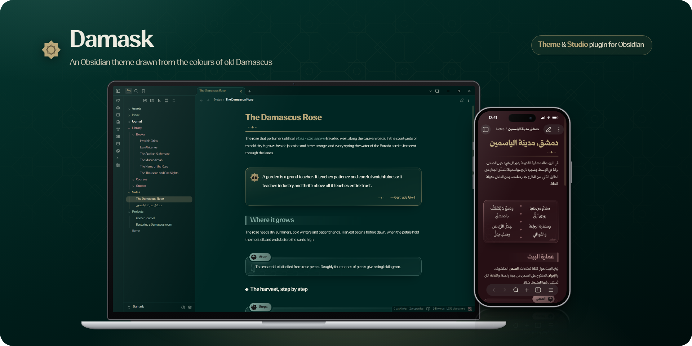
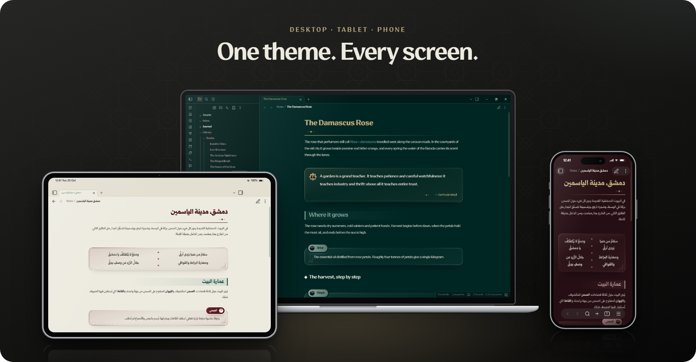
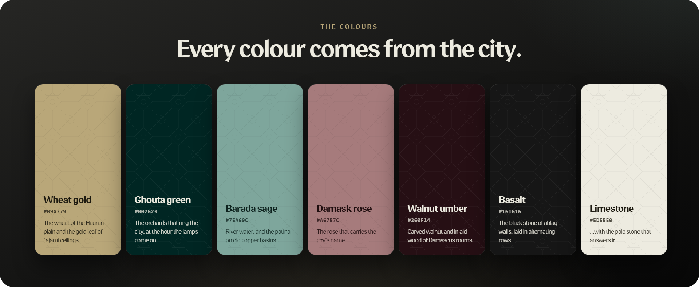
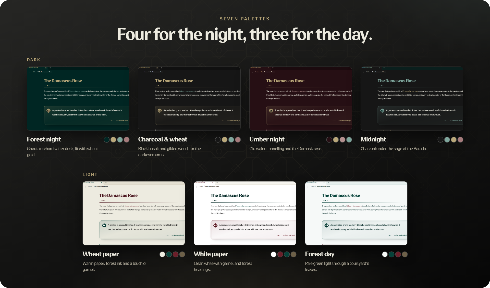
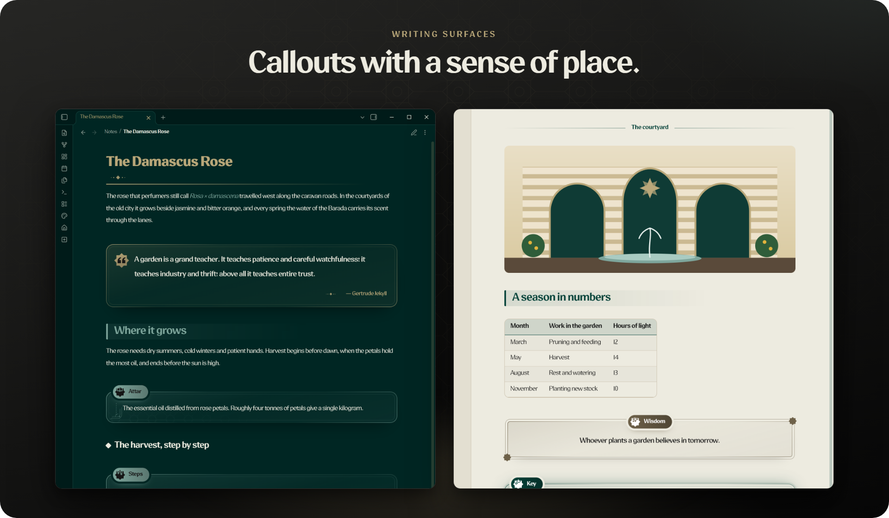
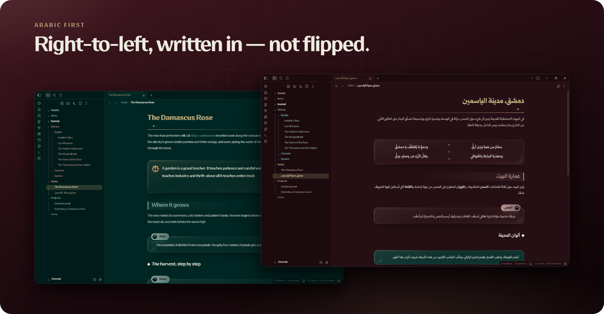
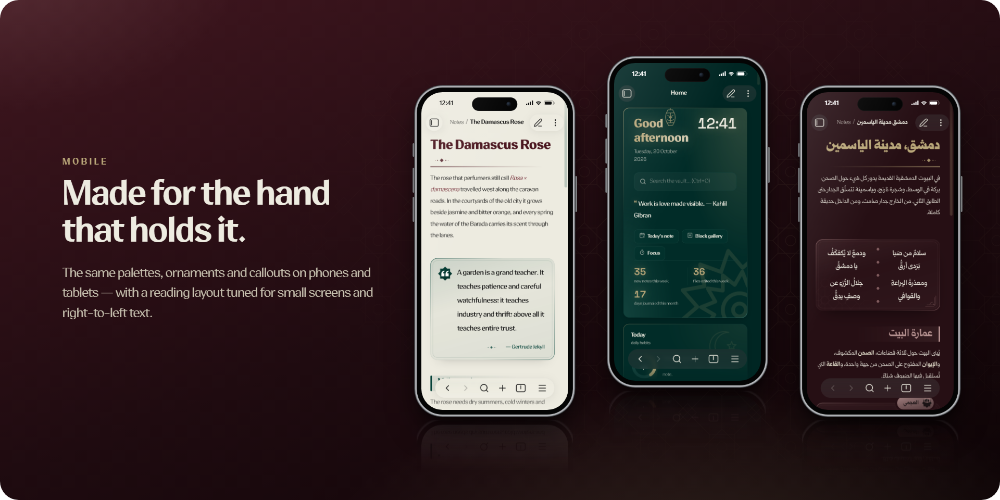

<div dir="rtl">

<div align="center">

[English](README.md) · **العربية** · [Français](README.fr.md) · [Español](README.es.md) · [Türkçe](README.tr.md)



<br>

### دمشق القديمة، لملاحظاتك.

ثيم لأوبسيديان مستوحى من ألوان دمشق القديمة وحجارتها وخشبها —<br>
هادئ بما يكفي للكتابة الطويلة، ومزخرف بما يكفي ليشعرك أنك في مكان.

<br>

[](CHANGELOG.md)
[](https://obsidian.md)
[](#لوحات-الألوان)
[](LICENSE)

✦ **استفد من Damask أكثر** مع إضافته المرافقة [**Damask Studio**](https://github.com/k7aleds8/damask-studio):<br>
أدرج أي مربع من معرض جاهز، وعاين كل لوحات الألوان مباشرة، وحوّل ملاحظة إلى لوحة بداية لخزنتك.

**[ابدأ من هنا](#ابدأ-من-هنا) · [نظرة عامة](#نظرة-عامة) · [قصة الاسم](#لماذا-damask) · [الألوان](#الألوان) · [لوحات الألوان](#لوحات-الألوان) · [الكتابة](#أسطح-الكتابة) · [العربية](#العربية-أولاً) · [المربعات](#مرجع-المربعات) · [أسئلة شائعة](#أسئلة-شائعة)**

</div>

<br>

## ابدأ من هنا

يعمل Damask بمجرد اختياره: الخط والزخارف والمربعات ولوحتا الألوان الافتراضيتان، *ليل الغابة* و*ورق القمح*، لا تحتاج إلى أي شيء آخر. وثلاث خطوات تكشف لك الباقي.

1. **ثبّت إضافة Style Settings** لتغيير لوحات الألوان والخيارات.
   *الإعدادات ← الإضافات المجتمعية ← تصفّح ←* [**Style Settings**](https://github.com/mgmeyers/obsidian-style-settings)، ثم *الإعدادات ← Style Settings ← Damask*. اختر أيّاً من اللوحات السبع، واضبط ارتفاع السطر وعرضه والورق المسطّر والعناوين البسيطة وغيرها. لا يستطيع أي ثيم أن يضيف صفحة إعدادات خاصة به، لذلك تعرض كل ثيمات أوبسيديان خياراتها بهذه الطريقة.
2. **افتح ملاحظة العرض** لترى كل المزايا دفعة واحدة.
   نزّل [**ملاحظة العرض بالعربية**](https://raw.githubusercontent.com/k7aleds8/damask/main/docs/Damask%20showcase.ar.md) (زر الفأرة الأيمن ← *حفظ الرابط باسم*) في خزنتك، أو [اقرأها هنا](docs/Damask%20showcase.ar.md). تعرض كل اقتباس وآية وقصيدة ولوحة وفاصل ومربع، وبجانب كلٍّ منها الكود الذي يصنعه، جاهزاً للنسخ.
3. **أضف Damask Studio** (موصى به). [الإضافة المرافقة](https://github.com/k7aleds8/damask-studio) أسهل طريق لاستخدام كل ما سبق: تدرج أي مربع من معرض بنقرة واحدة، وتختار لوحات الألوان بمعاينة حيّة، وتضيف لوحة بداية لخزنتك. *الإعدادات ← الإضافات المجتمعية ← تصفّح ← Damask Studio*.

> [!TIP]
> خط **itf Qomra Arabic** مضمَّن في الثيم. لاستخدام خط آخر اختره من *الإعدادات ← المظهر ← الخط*، دون أي إضافة.

## نظرة عامة

**هادئ.** تباعد مريح بين الأسطر، وعرض قراءة مناسب، وألوان دافئة بتباين منخفض تُبقي الصفحة ساكنة. لا شيء على الشاشة ينافس ما تكتبه.

**مزخرف بلا ازدحام.** للعناوين خط يتلاشى ومعيّن، وللاقتباسات هامش مذهّب، والفواصل قطع صغيرة من التطعيم. تتبع الزخارف هندسة الحرفة الدمشقية — نجمة الخاتم الثمانية وشبكة الجيرة — وتبقى بعيدة عن طريق النص.

**ثنائي اللغة منذ البداية.** صُمّم Damask للحرف العربي واللاتيني معاً. الملاحظات العربية تُعرض من اليمين إلى اليسار عرضاً حقيقياً لا بقلب الصفحة، وإعدادات الثيم مكتوبة بخمس لغات.

**كامل وحده.** لا يحتاج أي إضافة. لوحات الألوان والخيارات في [Style Settings](https://github.com/mgmeyers/obsidian-style-settings)، وكل ما عداها يعمل بمجرد اختيار الثيم.

<br>



<br>

## لماذا Damask

**Damask** كلمة إنجليزية جاءت مباشرة من اسم دمشق. حمل التجار في العصور الوسطى حريراً منسوجاً في المدينة، فسمّته أوروبا باسم مكانه: *damasco* بالإيطالية، و*damas* بالفرنسية، و*damask* بالإنجليزية. وهو القماش الذي يسمّيه أهل الشام حتى اليوم **الدامسكو**.

نقشة الدامسكو لا تراها إلا حين يقع عليها الضوء. الزخرفة منسوجة في القماش نفسه، خيوط لامعة بجانب خيوط مطفأة من لون واحد، فتظهر لمن يتأمّل وتختفي عمّن لا ينظر. وهذا بالضبط ما يحاول الثيم فعله: زخارفه مرسومة بتباين منخفض قريب من لون الصفحة، حاضرة لمن يبحث عنها، وهادئة لمن يقرأ.

وتحمل الكلمة أكثر من ذلك من المدينة:

- **الوردة الدمشقية** (*Rosa × damascena*) تُسمّى بالإنجليزية *Damask rose*، وتنمو في صحون البيوت الشامية، ومنها أخذ الثيم لونه الوردي.
- **Damask** اسم إنجليزي قديم أيضاً للون الوردي العميق، لون تلك الوردة.
- **الفولاذ الدمشقي**، نصال دمشق المموّجة، يُسمّى *Damask steel*، وفيه النقش المتموّج الخفي نفسه.

اسم قصير، سهل النطق بكل اللغات، ولا يخطئ أحد في نسبته إلى دمشق. نُشر الثيم لفترة قصيرة باسم *Damascene*، وهو الثيم نفسه باسم أسهل حفظاً.

## الألوان



لكل لون في Damask مكان في المدينة التي سُمّي باسمها.

| | اللون | الرمز | من أين جاء | أين تراه |
|---|---|---|---|---|
|  | **ذهبي القمح** | `#B9A779` | قمح سهل حوران، وأوراق الذهب في أسقف العجمي المرسومة | العناصر المميِّزة والعنوان الأول والروابط والزخارف في الوضع الداكن |
|  | **أخضر الغوطة** | `#002623` | البساتين التي تحيط بدمشق، ساعة تُضاء القناديل | خلفيات *الغابة*، ولون الحبر في الوضع الفاتح |
|  | **مريمي بردى** | `#7EA69C` | ماء نهر بردى، وصدأ الأحواض النحاسية القديمة | العنوان الثاني، والعناصر الثانوية، ولوحة *منتصف الليل* |
|  | **الوردة الدمشقية** | `#A67B7C` | الوردة التي تحمل اسم المدينة | العناصر الثالثة، ولوحة *عنبر الليل* |
|  | **عنّاب الجوز** | `#260F14` | خشب الجوز المحفور والمطعّم في القاعات الدمشقية | خلفية *عنبر الليل* |
|  | **البازلت** | `#161616` | الحجر الأسود في جدران الأبلق، يُرصف صفوفاً متعاقبة… | خلفيتا *الفحم* و*منتصف الليل* |
|  | **الحجر الكلسي** | `#EDEBE0` | …مع الحجر الفاتح الذي يقابله | النص في الوضع الداكن، وخلفية *ورق القمح* |

في اللوحات الفاتحة تنقلب الأدوار: يصبح الورق هو الأرضية، ويصبح الأخضر الغامق والعنّابي العميق  `#6B1F2A` هما الحبر.

## لوحات الألوان



| داكنة | | فاتحة | |
|---|---|---|---|
| **ليل الغابة** | بساتين الغوطة بعد الغروب، مضاءة بذهب القمح | **ورق القمح** | ورق دافئ، وحبر أخضر، ولمسة عنّابية |
| **الفحم والقمح** | بازلت أسود وخشب مذهّب، لأكثر الغرف عتمة | **الورق الأبيض** | أبيض نقي بعناوين عنّابية وخضراء |
| **عنبر الليل** | ألواح الجوز القديمة والوردة الدمشقية | **غابة النهار** | ضوء أخضر شاحب يتسلل بين أوراق الصحن |
| **منتصف الليل** | فحم تحت مريمي بردى | | |

اختر لوحة لكل وضع من **الإعدادات ← Style Settings ← Damask**، أو من تبويب **الثيم** في [Damask Studio](https://github.com/k7aleds8/damask-studio) مع معاينة حيّة لكل لوحة. وينتقل أوبسيديان بين اختيارك الداكن والفاتح مع النظام كالمعتاد.

## أسطح الكتابة



- **العناوين** لها زخارفها: خط يتلاشى ومعيّن تحت العنوان الأول، وشريط بجانب الثاني، ومعيّن صغير قبل الثالث. تفضّلها بسيطة؟ فعّل *العناوين البسيطة*.
- **الفواصل.** يتحوّل `---` إلى فاصل مزخرف. ولفاصل بعنوان اكتب `<div class="dm-divider">الصحن</div>`، وأضف `dots` أو `wave` أو `star` أو `double` إلى الصنف لشكل آخر.
- **الورق المسطّر.** أضف الصنف `dm-lined` إلى ملاحظة لتظهر خلفها خطوط دفتر خفيفة، أو فعّله لكل الملاحظات من Style Settings.
- **الاقتباسات والمربعات** تأتي بأشكال صُنعت للكتابة الطويلة: اقتباس مع قائله، وآية بين أقواس مزخرفة، وقصيدة بشطرين، وحكمة في إطار مزدوج، وخط زمني مرقّم. راجع [مرجع المربعات](#مرجع-المربعات).
- **الجداول ومربعات المهام والتضمينات والخصائص** كلها معاد تلوينها بألوان اللوحة.

```markdown
> [!quote|side]
> الحديقة معلّمة عظيمة؛ تعلّم الصبر والملاحظة الدقيقة.
>
> — غيرترود جيكل

> [!steps]
> 1. اقطف البراعم نصف المتفتحة قبل الشروق
> 2. احملها إلى الإنبيق خلال ساعة
> 3. قطّرها ببطء على نار هادئة
```

## العربية أولاً



يأتي Damask مع خط **itf Qomra Arabic**، وفيه تصميم عربي ولاتيني حقيقي، فتُقرأ الملاحظة التي تجمع اللغتين بصوت واحد. الملاحظات المكتوبة بالعربية تُعرض من اليمين إلى اليسار — العناوين والاقتباسات والمربعات وأعمدة القصائد والقوائم — بينما تبقى الملاحظات الإنجليزية في الخزنة نفسها من اليسار إلى اليمين. والزخارف التي تشير إلى اتجاه (الخطوط والأشرطة وعلامات الاقتباس) تتجه الاتجاه الصحيح في اللغتين.

تفضّل خطاً آخر؟ اكتب اسم أي خط مثبَّت في حقول الخط في الثيم، أو اختره من إعدادات المظهر في أوبسيديان، فهي الأعلى أولوية دائماً.

## الجوال



تعمل لوحات الألوان والزخارف والمربعات نفسها على آيفون وأندرويد وآيباد. وعلى الشاشات الصغيرة يضيق تخطيط القراءة — هوامش أصغر ومربعات بعرض الشاشة — وتبقى مساحات اللمس مريحة.

## التثبيت

**من داخل أوبسيديان** — *الإعدادات ← المظهر ← الثيمات ← Manage*، ابحث عن **Damask**، ثم *Install and use*. وثبّت **Style Settings** أيضاً إن أردت تغيير لوحات الألوان والخيارات.

**يدوياً** — نزّل `theme.css` و`manifest.json` من [أحدث إصدار](https://github.com/k7aleds8/damask/releases) إلى `.obsidian/themes/Damask/`، ثم اختر Damask من *الإعدادات ← المظهر*.

## خيارات الثيم

كل ما يلي في **Style Settings ← Damask**، مكتوباً بالإنجليزية والعربية والفرنسية والإسبانية والتركية.

| الخيار | الافتراضي |
|---|---|
| لوحة الوضع الداكن · لوحة الوضع الفاتح | ليل الغابة · ورق القمح |
| خط النص · خط الواجهة | itf Qomra Arabic |
| ارتفاع السطر | 1.9 |
| عرض القراءة | 46 rem |
| ورق مسطّر في كل الملاحظات | مطفأ |
| عناوين بسيطة | مطفأ |
| فقرات مضبوطة الطرفين | مطفأ |
| واجهة مسطّحة (بلا ظلال) | مطفأ |
| أيقونات ملوّنة في الشريط الجانبي | مطفأ |

## مرجع المربعات

| المربع | استخدمه لـ | الخيارات بعد `\|` |
|---|---|---|
| `[!quote]` | اقتباس، وقائله في السطر الأخير | `big` `side` `forest` `umber` `wheat` `title` |
| `[!ayah]` | آية أو بيت، بين أقواس مزخرفة | `title` |
| `[!poem]` | قصيدة بشطرين: اكتب كل شطر عنصراً في قائمة | `title` |
| `[!wisdom]` | حكمة في إطار مزدوج | |
| `[!definition]` | مصطلح ومعناه | |
| `[!key]` | الفكرة الجوهرية التي يجب تذكّرها | |
| `[!steps]` | خط زمني مرقّم (استخدم قائمة مرقّمة) | |
| `[!box]` | لوحة بسيطة | `forest` `umber` `wheat` `charcoal` `outline` `glass` `center` `tab` `title` |
| `[!lined]` | ورقة مسطّرة بهامش | `title` |

مربعات أوبسيديان الأصلية — `note` و`tip` و`warning` و`danger` وغيرها — معاد تلوينها بألوان اللوحة: الأخضر للملاحظات والنصائح، والذهبي للتحذيرات والأسئلة، والعنّابي للخطر. وأضف `-` أو `+` بعد أي نوع ليصبح قابلاً للطي.

<details>
<summary><b>أمثلة</b></summary>

<br>

```markdown
> [!poem|title] أحمد شوقي
> - سلامٌ من صَبا بَرَدى أرقُّ
> - ودمعٌ لا يُكفكَفُ يا دمشقُ

> [!definition] العطر
> الزيت العطري المقطّر من بتلات الورد.

> [!box|forest]
> أخضر الغوطة، وذهب القمح، والبازلت، والجوز: ألوان المدينة الأربعة.

> [!lined|title] مذكرة
> الياسمين يزهر من أيار حتى تشرين، وأجمل ساعاته بعد المغرب.
```

</details>

## لكتّاب المقتطفات

كل لوحة تضبط متغيّرات `--dm-*` نفسها، فأي مقتطف CSS تكتبه بها يتبع اللوحة النشطة تلقائياً.

| المتغيّرات | ما هي |
|---|---|
| `--dm-bg` `--dm-bg2` `--dm-bg3` | الصفحة، والشريط الجانبي، والأسطح البارزة |
| `--dm-text` `--dm-muted` `--dm-faint` | النص، من الأقوى إلى الأخفت |
| `--dm-accent` `--dm-accent2` `--dm-accent3` | الألوان المميِّزة الثلاثة للوحة؛ وللأولين صيغة `-rgb` أيضاً |
| `--dm-forest` `--dm-wheat` `--dm-umber` `--dm-charcoal` | عائلات لونية مسمّاة، لكل منها `-bg` و`-text` و`-rgb` |
| `--dm-folder-1` … `--dm-folder-9` | تسعة ألوان للمجلدات منسجمة مع اللوحة |
| `--dm-h1` … `--dm-h6` | ألوان العناوين |
| `--dm-mask-star` `--dm-mask-diamond` `--dm-mask-wave` `--dm-mask-quote` `--dm-mask-khatam-ring` | أشكال الزخارف، لاستخدامها أقنعةً في CSS |

```css
/* لون مجلد يتغيّر مع اللوحة */
.nav-folder-title[data-path="Projects"] { color: var(--dm-folder-2); }
```

## الإضافة المرافقة


لا يحتاج الثيم إلى شيء آخر، لكنه صُمّم جنباً إلى جنب مع **[Damask Studio](https://github.com/k7aleds8/damask-studio)**، وأجمل ما يكونان معاً. تضيف الإضافة:

- **معرض الكتل** — كل اقتباس وآية وقصيدة ولوحة وفاصل مما سبق، تدرجه بنقرة واحدة أو بكتابة `؛؛` في الملاحظة.
- **منتقي لوحات الألوان** مع معاينة حيّة للوحات السبع، دون الحاجة إلى Style Settings.
- **لوحة البداية** — تحية، واقتباس اليوم، والعادات، والمهام، وإحصاءات التركيز، ونشاط الخزنة.
- **تخطيط الرسوم والصور، وألوان المجلدات والعناوين، ومؤقّت التركيز، وفحص صحة الخزنة**، ولكلٍّ منها مفتاح تشغيل.

**التثبيت:** *الإعدادات ← الإضافات المجتمعية ← تصفّح ←* ابحث عن **Damask Studio** ← *Install* ← *Enable*.

## أسئلة شائعة

**هل أحتاج إلى إضافة؟**
لا. الثيم كامل وحده، وStyle Settings لا تلزم إلا لتغيير لوحات الألوان والخيارات. ولأفضل تجربة ننصح بإضافة [Damask Studio](https://github.com/k7aleds8/damask-studio).

**ثبّتّه حين كان اسمه Damascene.**
ثبّت **Damask** من متصفح الثيمات واختره، فهو الثيم نفسه. وتأخذ Damask Studio إعدادات Damascene Studio السابقة تلقائياً، وتبقى كتل `damascene-home` القديمة تعمل.

**كنت أستخدم ثيم قمرة.**
انتقل إلى Damask: لوحات الألوان والمربعات هي نفسها، والأصناف صارت تبدأ بـ `dm-` بدل `qm-`. غيّر أصناف `qm-` في ملاحظاتك، أو دع فحص الصحة في Damask Studio يفعل ذلك عنك.

**هل أستطيع استخدام خطي الخاص؟**
نعم. اكتب اسمه في حقول الخط في Style Settings، أو اختره من إعدادات المظهر في أوبسيديان، فهي الأعلى أولوية.

**كيف صُنعت هذه الصور؟**
من خزنة تجريبية داخل هذا المستودع، فلا تظهر فيها ملاحظات شخصية لأحد. الأمر `npm run demo` يبنيها، و`npm run mockups` يحوّل اللقطات إلى الصور التي تراها.

## شكر وحقوق

صنعه [k7aleds8](https://github.com/k7aleds8). تتبع الزخارف هندسة الخشب والقيشاني في دمشق: نجمة الخاتم الثمانية وشبكة الجيرة.

- **الخط:** *itf Qomra Arabic* من Indian Type Foundry برخصة مستقلة، ولا تشمله رخصة MIT لهذا المستودع. راجع [fonts/NOTICE.md](fonts/NOTICE.md).
- **الاقتباسات في الصور:** غيرترود جيكل وجبران خليل جبران، والقصيدة لأحمد شوقي (1868–1932).
- **الكود:** [MIT](LICENSE).

</div>
